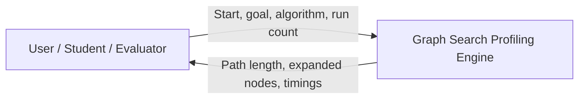
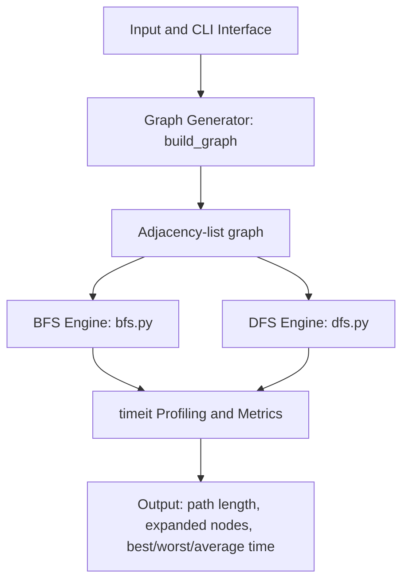
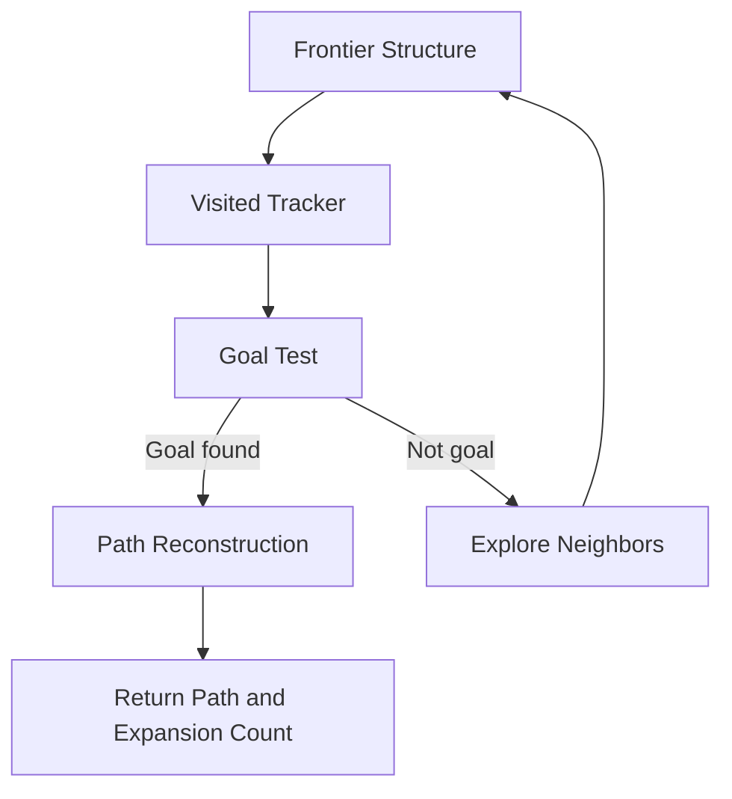

# Architecture — Graph Search Profiling Engine

This document summarizes the four levels of the C4-style architecture described in the SLE-3 design.

## Level 1 — Context

The user configures the source node, goal node, and algorithm mode. The system runs graph traversal and displays performance metrics.

## Level 2 — Containers

- **CLI:** parses start, goal, node count, repeat count, and algorithm selection.
- **Graph generator:** creates a deterministic adjacency list with sequential edges and shortcuts.
- **Search engines:** run BFS and DFS separately.
- **Profiler:** repeats each search with Python's timeit module.
- **Output:** displays traversal and timing metrics.

## Level 3 — Search engine components

BFS uses a FIFO deque; DFS uses a LIFO stack. Both track visited nodes to prevent repeated expansion. BFS reconstructs the route from parent pointers. DFS carries a candidate path with each stack entry.

## Level 4 — Code-level mapping

| Function / module | Responsibility |
|---|---|
| `build_graph(size)` in `graph.py` | Creates the adjacency-list graph. |
| `bfs(start, goal, graph)` in `bfs.py` | Iterative BFS, parent tracking, and path reconstruction. |
| `dfs(start, goal, graph)` in `dfs.py` | Iterative DFS using a stack and visited set. |
| `profile_search(...)` in `profile.py` | Measures repeated runtime and calculates best, worst, and average milliseconds. |
| `main()` in `profile.py` | Parses CLI options and prints results. |
| `SearchTests` in `tests/test_search.py` | Checks core graph-search behavior and profiling metrics. |

## Design decisions

1. **Iterative DFS:** avoids Python recursion-depth limitations.
2. **Adjacency list:** compact representation for graph neighbors.
3. **Separate BFS and DFS modules:** keeps traversal logic independently testable.
4. **Deterministic graph:** makes repeated comparisons reproducible at the algorithm level.
5. **Repeated timing:** reports a range and mean instead of relying on a single timing sample.
