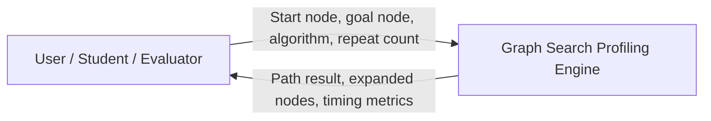
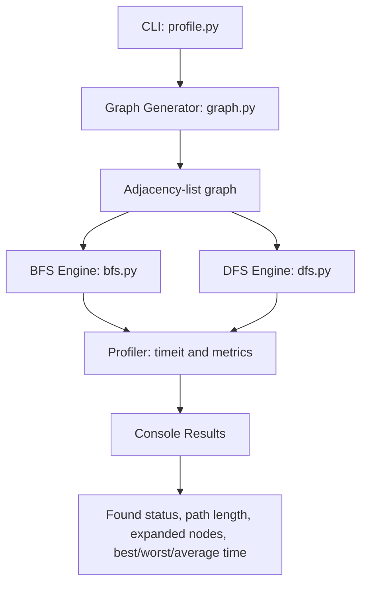
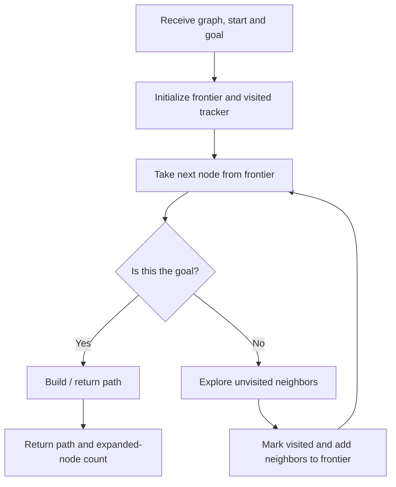
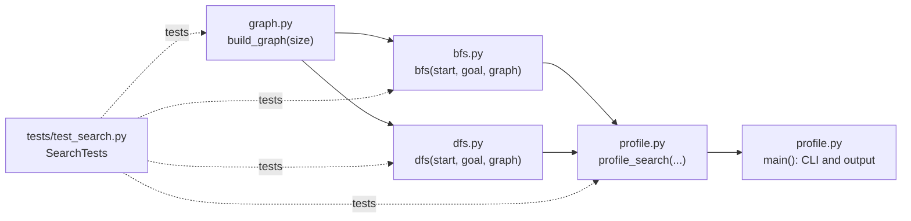

# SLE-3: Graph Search Profiling Engine (BFS vs DFS)

**Student:** Aditya Sanjay Patil  
**PRN:** 25UAM026  
**Division:** A  
**Course:** 02AML204 — Introduction to Artificial Intelligence

## 1. Project overview

This project compares Breadth-First Search (BFS) and Depth-First Search (DFS) on a deterministic graph of 1,000 nodes. It reports whether the goal was found, path length, number of expanded nodes, and execution time. Timing uses Python's built-in `timeit` module and defaults to three runs.

**Default configuration:** start node 0, goal node 999, graph size 1,000.

## 2. Project files

| File | Purpose |
|---|---|
| `graph.py` | Builds the deterministic adjacency-list graph with sequential edges and forward shortcuts. |
| `bfs.py` | Iterative BFS using a FIFO queue and parent mapping for path reconstruction. |
| `dfs.py` | Iterative DFS using a LIFO stack and visited-node tracking. |
| `profile.py` | Command-line runner and timing summary for BFS, DFS, or both. |
| `tests/test_search.py` | Unit tests for graph creation, traversal, unreachable targets, and timing metrics. |
| `CONTRIBUTION_LOG.md` | Work summary, AI contribution note, and verification checklist. |
| `ARCHITECTURE.md` | Extended architecture explanation and code-level mapping. |

## 3. Requirements

- Python 3.9 or newer
- No third-party packages are required

## 4. Run the project

Run both algorithms with the default 1,000-node graph:

```bash
python profile.py
```

Run only BFS or DFS:

```bash
python profile.py --algorithm bfs
python profile.py --algorithm dfs
```

Change the graph size, start/goal, or repeat count:

```bash
python profile.py --nodes 500 --start 0 --goal 499 --repeat 5
```

The start and goal must be node IDs between 0 and `nodes - 1`.

## 5. Run tests

```bash
python -m unittest discover -s tests -v
```

## 6. How the comparison works

- **BFS:** explores nodes level by level using a FIFO queue. In an unweighted graph, it finds a shortest path in terms of number of edges.
- **DFS:** explores along a branch using a LIFO stack. It can find a path, but does not generally guarantee the shortest path.
- **Expanded nodes:** counts nodes removed from the frontier and processed by the search.
- **Timing:** each algorithm is measured repeatedly; best, worst, and mean elapsed milliseconds are reported.

The graph generator and traversal order are deterministic, but timing results can vary with the computer and system load. Run the benchmark locally and record your actual measurements in your submission rather than copying example timings.

## 7. C4 Architecture Diagrams

The following diagrams summarize the system from the user context down to the code-level components. GitHub renders these Mermaid diagrams directly in this README.

### Level 1 — System Context

Shows who uses the system and the information exchanged with it.



### Level 2 — Container / High-Level Structure

Shows the major parts of the program and how data flows through them.



### Level 3 — Component Diagram: Search Engine

Shows the common traversal steps used by the search algorithms. BFS uses a FIFO queue; DFS uses a LIFO stack.



### Level 4 — Code-Level Mapping

Maps the architecture responsibilities to source files and key functions.



For additional explanation and the design decisions, see [ARCHITECTURE.md](ARCHITECTURE.md).

## 8. Design decisions

1. **Iterative DFS:** avoids Python recursion-depth limitations.
2. **Adjacency list:** stores graph neighbors compactly.
3. **Separate BFS and DFS modules:** keeps traversal logic independently testable.
4. **Deterministic graph:** makes graph traversal comparisons reproducible.
5. **Repeated timing:** reports best, worst, and average duration instead of relying on a single sample.
